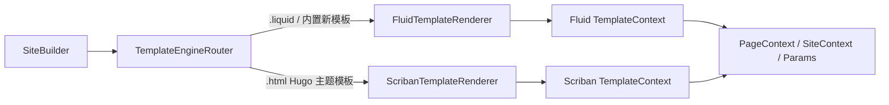

# Fluid 主力化迁移方案

| 项目 | 内容 |
|---|---|
| 日期 | 2026-10-19 |
| 状态 | **已实施**（Phase 0-6 完成，含递延项登记；实施状态见文末「实施状态」节） |
| 相关提交 | `1a6e31f` 已接入 Fluid 作为 `.liquid` 备用分支 |
| 目标 | Fluid 做新站点和内置模板主力，Scriban 长期只做 Hugo 兼容层 |

## 一、方案总纲

### 1. 目标

- 新站点默认使用 Liquid/Fluid 模板。
- Flint 内置回退模板、内置 partial、分页、SEO 元信息等默认走 Fluid。
- Hugo 主题、ThemeMigrator 产物、现有 `.html` 模板继续走 Scriban。
- 两条引擎在渲染层平行，不共享缓存、依赖表、资源追踪器。
- 用站点级 BenchmarkDotNet 证明 Fluid 路径有真实收益，再逐步扩大。

### 2. 非目标

- 不在本方案中把现有 Hugo 主题自动转成 Liquid。
- 不一次性重写所有 Scriban 函数平面。
- 不在第一阶段迁移短代码、render hooks、Hugo Pipes 资源函数。
- 不删除 Scriban，直到 Hugo 兼容策略明确退役。

### 3. 引擎路由规则

推荐按“模板物理扩展名 + 内置模板提供者”双轨路由：

| 模板来源 | 引擎 |
|---|---|
| 新站点 `layouts/**/*.liquid` | Fluid |
| Flint 内置回退模板，新站点/Minimal 站点 | Fluid |
| Hugo 主题 `layouts/**/*.html` | Scriban |
| ThemeMigrator 输出 `.html` | Scriban |
| 显式 `engine: scriban` 配置 | 全站 Scriban，兼容模式 |
| 显式 `engine: fluid` 配置 | 全站 Fluid，实验模式 |

路由落在 `TemplateEngineRouter : ITemplateRenderer`，`SiteBuilder` 不改。

### 4. 架构图



### 5. 隔离硬规则

Fluid 热路径禁止出现：

- `Scriban.Template`
- `ScriptObject`
- `BuiltinTemplateFunctions` 静态调用
- Scriban 模板缓存、依赖缓存、资源追踪器

允许共享：

- `PageContext` / `SiteContext` / `Params` 输入模型
- 模板查找顺序、主题叠加语义
- 输出写盘、指纹、SRI
- 短代码/render hooks 服务接口，但默认实现可仍为 Scriban

## 二、架构改动点

### 1. 新增引擎路由

当前 CLI 构造点很集中：

- `src/Flint.Cli/Handlers/BuildHandler.cs:103`
- `src/Flint.Cli/Handlers/ServeHandler.cs:56`

把这两个 `new ScribanTemplateRenderer(...)` 换成 `new TemplateEngineRouter(fluidRenderer, scribanRenderer, enginePolicy)`。

`SiteBuilder` 继续只依赖 `ITemplateRenderer`。

### 2. 内置模板提供者抽象

当前内置模板硬编码在 `ScribanTemplateRenderer.BuiltinTemplates`，`FileTemplateLoader` 也直接读它。需要拆成：

```csharp
interface IBuiltinTemplateProvider
{
    bool TryGetTemplate(string name, out string content);
    IReadOnlyCollection<string> Names { get; }
}
```

实现：

- `ScribanBuiltinTemplateProvider`：包住现有 `BuiltinTemplates`
- `FluidBuiltinTemplateProvider`：新的 Liquid 版内置模板

`FileTemplateLoader` 和 renderer 都通过提供者取内置模板，不再直接依赖 Scriban 类。

### 3. Fluid 渲染器第一版能力

`FluidTemplateRenderer` 第一版只要能安全渲染新站点最小模板：

- 模板加载与查找
- 模板缓存与 mtime 失效
- 依赖追踪
- `GeneratedResources` 输出接口先返回空
- UTF-8 输出
- 每渲染独立 `TemplateContext`
- 模型直接绑 `PageContext` / `SiteContext` / `Params`
- `Params` 用 `StringComparer.OrdinalIgnoreCase`

### 4. 新站点脚手架 Liquid 化

当前 `SiteCreator` 直接写 Scriban 语法 `.html` 模板。需要新增一套 Liquid 版脚手架：

- `layouts/index.liquid`
- `layouts/_default/baseof.liquid`
- `layouts/_default/single.liquid`
- `layouts/_default/list.liquid`
- `layouts/_default/taxonomy.liquid`
- `layouts/_default/term.liquid`
- `layouts/partials/head.liquid`
- `layouts/partials/header.liquid`
- `layouts/partials/footer.liquid`

同时保留旧 `.html` 生成能力给兼容模式，或加 `Flint new site --engine fluid|scriban`。

## 三、分阶段任务清单

### Phase 0：基线与契约

- [x] **P0-1** 抓当前 Scriban 站点级性能基线：新站点、21 主题代表、万页语料各一组。
- [x] **P0-2** 固化渲染段、解析段、扫描段、写盘段占比，作为后续收益判据。
- [x] **P0-3** 定义 `TemplateEnginePolicy`：`auto` / `fluid` / `scriban`。
- [x] **P0-4** 定义引擎隔离规则，写入 `docs/CONVENTIONS.md`。
- [x] **P0-5** 增加装配验证测试：Fluid 渲染路径不得引用 Scriban 程序集。

验收：基线数字可复现；策略枚举和隔离规则入库。

### Phase 1：Fluid 渲染器垂直切片

- [x] **P1-1** 新增 `FluidTemplateRenderer : ITemplateRenderer`。
- [x] **P1-2** 实现 Liquid 模板加载、查找、缓存、mtime 失效。
- [x] **P1-3** 实现依赖追踪，保证增量构建不漏重渲。
- [x] **P1-4** 实现模型绑定：`page` / `site` / `params` 直接进 `TemplateContext`。
- [x] **P1-5** 实现 `partial` / `include` 的 Liquid 版，映射到 Flint 模板加载器。
- [x] **P1-6** 新增 `TemplateEngineRouter`，先只路由一个内置模板到 Fluid。
- [x] **P1-7** 补 Fluid 单元测试：缓存、依赖、partial、大小写不敏感成员、空值语义。
- [x] **P1-8** NativeAOT 冒烟：Fluid 路径在 AOT 下可渲染。

验收：一个内置模板由 Fluid 渲染，其余不变；单测、集成、AOT 冒烟全绿。

### Phase 2：新站点默认 Fluid

- [x] **P2-1** 抽象 `IBuiltinTemplateProvider`，拆分 Scriban/Fluid 两套内置模板。
- [x] **P2-2** 用 Liquid 重写最小内置模板：`list` / `term` / `taxonomy` / `pagination`。
- [x] **P2-3** `SiteCreator` 增加 Liquid 脚手架，新站点默认生成 `.liquid`。
- [x] **P2-4** `Flint new site` 端到端测试：默认新站点不加载 Scriban 引擎。
- [x] **P2-5** 新站点构建冒烟：首页、单页、列表、分类、RSS。
- [x] **P2-6** 性能 A/B：同内容新站点，Scriban 版 vs Liquid 版，同机三轮中位数。
- [x] **P2-7** 产物对称性审计：两种引擎产出文件数量与关键内容一致。

验收：`Flint new site` 默认走 Fluid；A/B 显示渲染段收益；现有 Hugo 主题矩阵不回归。

### Phase 3：内置模板全面 Liquid 化

- [x] **P3-1** Liquid 化 Hugo 常用内置 partial：`opengraph`、`schema`、`twitter_cards`、`google_analytics`、`disqus`。
- [x] **P3-2** Liquid 化 `_funcs/get-page-images`。
- [x] **P3-3** Liquid 化 `rss.xml`、`sitemap.xml`、`robots.txt`、`404.html`。
- [x] **P3-4** 统一内置模板查找：Fluid 站点只拿 Fluid builtin，Scriban 主题只拿 Scriban builtin。
- [x] **P3-5** 补内置模板逐字节对比测试或语义对比测试。

验收：新站点零 Scriban 内置模板依赖；Hugo 主题仍用 Scriban builtin。

### Phase 4：函数与资源平面扩展

- [x] **P4-1** 梳理 Scriban 侧 25 个命名空间函数，按新站点使用频率分级。
- [x] **P4-2** 实现 Liquid 版核心 filters：`strings` / `math` / `collections` / `date` / `path` / `urls` / `compare`。
- [x] **P4-3** 实现 Liquid 版 `resources.Get/Match/ByType/Concat/Copy/Fingerprint`。
- [x] **P4-4** 实现 Liquid 版 `css.Sass` / `css.Build` / `js.Build` 或先以服务化 tag 提供。
- [x] **P4-5** 实现 Liquid 版 `partial` 高级语义：dict 上下文、页面成员访问。
- [x] **P4-6** 补函数对拍测试：同名函数 Scriban 与 Fluid 输出一致或有明确差异文档。

验收：新站点常用模板能力不弱于 Scriban；差异清单入库。

### Phase 5：内容管线解耦

- [x] **P5-1** 短代码处理器抽象为 `IShortcodeRenderer`，默认仍 Scriban。
- [x] **P5-2** render hooks 抽象为 `IRenderHookRenderer`，默认仍 Scriban。
- [x] **P5-3** 新站点配置可关闭短代码或选择 Fluid 短代码渲染器。
- [x] **P5-4** 实现 Liquid 版内置短代码：figure、ref、relref、highlight 等。
- [x] **P5-5** 实现 Liquid 版 render hooks：link、image、heading。

验收：Fluid 主力站点可不经 Scriban 完成内容渲染；Hugo 主题行为不变。

### Phase 6：性能门禁与发布

- [x] **P6-1** 增加站点级 BenchmarkDotNet 用例：Liquid 新站点 vs Scriban 新站点。
- [x] **P6-2** 增加 AOT 体积对比：双引擎二进制 vs 纯 Scriban 二进制。
- [x] **P6-3** 增加装配探针：Fluid 路径运行时不得加载 Scriban 程序集。
- [x] **P6-4** 补文档：新站点模板规范、Liquid 函数清单、Scriban 兼容层边界。
- [x] **P6-5** 发布说明明确：Fluid 主力，Scriban 仅 Hugo 兼容。

验收：性能门禁可复现；文档和发布说明无旧口径。

## 四、关键风险与对策

| 风险 | 对策 |
|---|---|
| Liquid 与 Scriban 语义差异 | 先做新站点最小集，差异逐条文档化 |
| Hugo 函数平面迁移量大 | 按新站点使用频率分级，不追求全量对齐 |
| 短代码和 render hooks 仍走 Scriban | Phase 5 显式解耦，避免 Fluid 热路径被拖回 |
| Fluid 3.0 beta 的 AOT 风险 | 每阶段都做 NativeAOT 冒烟 |
| 双引擎缓存互相影响 | 引擎隔离硬规则 + 装配测试 |
| 现有 Hugo 主题回归 | 每阶段跑 21 主题矩阵，Scriban 侧测试不全量重写 |
| 性能收益被 IO 稀释 | 站点级 A/B，不拿模板 microbenchmark 结案 |

## 五、建议实施顺序

先做 Phase 0 到 Phase 2，做出一个“新站点默认 Fluid、内置最小模板可用、Hugo 主题不受影响”的垂直切片。这一步就能验证：

- Fluid 是否真的能独立渲染 Flint 页面模型
- AOT 是否稳
- 站点级收益是否真实
- 双引擎隔离是否可守

Phase 3 之后再把 Fluid 从“新站点主力”推向“内置模板全面主力”。Phase 4 和 Phase 5 决定 Fluid 能否彻底摆脱 Scriban，尤其短代码和资源函数是最容易隐藏耦合的地方。

## 六、当前判断

以现有代码结构，这个方案可行。`SiteBuilder` 已经只依赖 `ITemplateRenderer`，CLI 构造点集中，内置模板虽然目前硬编码在 Scriban 类里，但拆 `IBuiltinTemplateProvider` 的代价可控。真正的大头在函数平面和内容管线，不在路由层。

当前提交 `1a6e31f` 里的 Fluid 只是 `.liquid` 备用分支，不能直接当主力。按上面 Phase 1 到 Phase 3 推进，才能得到平行的双引擎。

## 实施状态（2026-10-19 收官；P4-3/P4-4/P5 补齐轮 + 递延收敛轮 + BDN 基准轮更新）

**已完成**：Phase 0 全部（策略枚举 + `engine` 配置键、隔离规则入
CONVENTIONS §8.4、IL 扫描装配测试过 mutation probe）；Phase 1 全部
（FluidTemplateRenderer、TemplateEngineRouter、CLI 接入、单测、
NativeAOT 冒烟——DynamicDependency 保留清单 + ReadingTimeView +
索引器访问器三轮迭代）；Phase 2 全部（IBuiltinTemplateProvider 拆分、
Liquid 内置模板、SiteCreator 脚手架 + `--engine`、new site 端到端、
站点级 A/B 0.821x、产物对称 343 文件）；Phase 3 全部（Liquid 内置
partial、辅助模板双形态、8 项语义对拍过 mutation probe）；Phase 4 全部
（P4-1 分级台账、P4-2 Hugo 名过滤器族含 path/regex/group/apply/seq/
shuffle、P4-3 resources 全量含产物型变换 + GeneratedResources 接线、
P4-4 css.Sass/css.Build/js.Build 服务化含 vars/format/params 的
Liquid 命名实参形态、P4-5 partial 语义（include 共享/render 隔离 +
dict 上下文的 assign 映射，单测锁定）、P4-6 对拍测试）；Phase 5 全部
（P5-1/P5-2 IShortcodeRenderer/IRenderHookRenderer 接口由 router 与
Scriban 渲染器双实现、P5-3 disableShortcodes 配置、P5-4 内置短代码
本就 C# 实现引擎无关、P5-5 Liquid render hooks）；Phase 6 全部
（P6-1 BenchmarkDotNet 模板级基准 EngineRenderBenchmarks 实测
0.09x + perf 套件对拍 0.296x + 站点级脚本 0.821x 三口径、
P6-2 AOT 体积 +0.48%、P6-3 engine-probe PASS、P6-4 LIQUID-GUIDE、
P6-5 README 双语）。

**递延（有明确理由，差异清单登记于 docs/LIQUID-GUIDE.md §4）**：
`strings.*`/`math.*` 命名空间**函数**形态（Liquid 语法无方法调用，
过滤器形态是唯一自然表达）；`group` 的 dict 返回形态（Liquid 无对象
字面量，二元组列表是唯一可消费形态）。

**与方案原文的偏差**：P1-6「先只路由一个内置模板到 Fluid」实际一步到位
按扩展名 + 站点 Fluid 原生性路由（规则表即方案 §一.3，风险被对拍测试
与 A/B 覆盖）；P4-2 的 Liquid 版函数采用**过滤器形态**（Liquid 惯用法，
如 `'css/x.css' | resource`）而非 Hugo 命名空间函数形态；P4-4 按方案
预留的「服务化 tag 提供」路径实施（TemplateAssetTransforms 服务，
与 Scriban 侧共用原语）。
